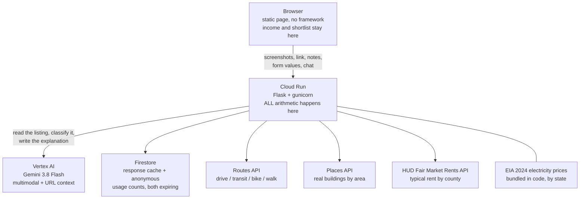

# True Cost of Rent

**A listing price is not what you pay.** Give it a screenshot of a rental
listing, a link, or both, and it works out what the place actually costs every
month, names the charges the listing stayed silent about, tells you what to
ask the leasing office, and ranks the places you are weighing up by what they
really cost rather than what they advertise.

Built for GDG Build with AI x Hacktoberfest at Virginia Tech, 24 to 25 October
2026. Theme: **AI for Housing**. MLH track: **Best Use of Google Cloud**.

**Live:** https://truecost-281435823029.us-east1.run.app

---

## Contents

- [The problem](#the-problem)
- [What we measured](#what-we-measured)
  - [Run 1. A listing read end to end](#run-1-a-listing-read-end-to-end-by-the-app)
  - [Runs 2 to 10. Market sweep](#runs-2-to-10-market-sweep)
  - [Run 11. Does the electricity data move the answer](#run-11-does-the-electricity-data-actually-move-the-answer)
  - [The result across all ten](#the-result-across-all-ten)
- [Who this is for](#who-this-is-for)
- [What it does](#what-it-does)
- [Architecture](#architecture)
- [How the AI is used, and what it never does](#how-the-ai-is-used-and-what-it-never-does)
- [When the model got it wrong](#when-the-model-got-it-wrong)
- [Grounding and safety](#grounding-and-safety)
- [Privacy and data retention](#privacy-and-data-retention)
- [Accessibility](#accessibility)
- [Data sources](#data-sources)
- [Cost](#cost)
- [Running it yourself](#running-it-yourself)
- [Tests](#tests)
- [Limitations](#limitations)
- [Where this goes next](#where-this-goes-next)

---

## The problem

Over 46 percent of US renters spend more than 30 percent of their income on
housing, and 23 percent spend more than half. People choose between places
using the number on the listing, and the number on the listing is not the
number that leaves their account. Utilities, parking, valet trash, water
billed back by formula, admin fees, amenity fees and the cost of the commute
are all real, and none of them are in the headline price.

The people this hurts most are renting on their own for the first time. They
do not know those charges exist, so they do not know to ask. A listing is not
dishonest when it omits them. It simply answers a different question than the
one the reader is asking.

---

## What we measured

Rather than assert that listings understate cost, we measured it. Ten real
listings were run through the application. Everything below is reproduced
from [evidence/TRIAL_LOG.md](evidence/TRIAL_LOG.md), which is generated by
[`evidence/build_log.py`](evidence/build_log.py) by calling the application's
own `analyze()` function. Nothing here is estimated by hand, and any figure
can be regenerated with `python3 evidence/build_log.py`.

Listings were retrieved on 25 October 2026. Rents change, so a figure checked
later may differ from the one recorded here.

### Run 1. A listing read end to end by the app

The only run where the app did the reading as well as the arithmetic. Six screenshots and the listing URL were given to it and merged into one set of figures.

**Chase Apartments, 421-461 Roanoke St E, Blacksburg VA**  
Source: https://www.apartments.com/chase-apartments-blacksburg-va/1cxxjw6/  
Read from: 6 screenshots plus the link, merged.

Inputs the app arrived at after reading the listing:

```json
{
  "rent": 3576,
  "bedrooms": 4,
  "roommates": 4,
  "state": "VA",
  "income": 2500,
  "lease_months": 12,
  "parking": 10,
  "commute_miles": 0.7,
  "commute_mode": "drive",
  "utilities_included": [
    "trash",
    "internet"
  ]
}
```

The figures below are what the deployed application returned on 25 October 2026 with those six screenshots attached. Calling `analyze()` on the inputs alone returns $68 of utilities rather than $70, because the signals read out of the photographs only exist when real screenshots are present. The observed run is the evidence, so the observed figures are the ones recorded here.

| line | per month |
|------|----------:|
| rent share | $894 |
| utilities | $70 |
| parking | $10 |
| commute | $6 |
| insurance | $15 |
| **true monthly cost** | **$995** |

- advertised, their share: **$894**
- true monthly cost: **$995**
- difference: **$101 a month**, $1,212 a year
- **11.3 percent more than the listing price**
- burden: 36 percent advertised, 40 percent true

What the app caught that the listing did not state outright:

- priced per bed rather than per apartment, so the advertised $894 is one room in a four bedroom unit
- parking has a section on the listing with no price in it
- heating type never stated, worth up to $69 a month
- air conditioning type never stated, worth up to $15 a month
- the phrase "subject to change without notice" in the lease wording
- total unresolved spread, up to $394 a month

The band where the listing misleads:

```
advertised crosses 30 pct at  894 / 0.30 = 2,980
true cost crosses 30 pct at   995 / 0.30 = 3,317
```
Anyone earning between **$2,980 and $3,317** a month passes the 30 percent test on this listing's advertised price and fails it on what the place actually costs.


### Runs 2 to 10. Market sweep


Nine further Blacksburg listings. The app was given only what a listing states: advertised rent, bedroom count and state. No utilities were marked as covered, because none of these listings said any were. Income held at $2,500 a month after tax for every run, and roommates set equal to bedrooms. This is the floor, not the full picture: parking, fees and commute are all zero here because none were stated.

| # | listing | source | advertised | share | true cost | difference | percent |
|---|---------|--------|-----------:|------:|----------:|-----------:|--------:|
| 2 | [1018 Montgomery St NW Unit B, Blacksburg VA](https://www.redfin.com/city/2010/VA/Blacksburg/cheap-2-bedroom-apartment) | Redfin | $1,000 | $500 | $646 | $146 | 29.3% |
| 3 | [318 Willard Dr SE Unit 02, Blacksburg VA](https://www.redfin.com/neighborhood/761410/VA/Blacksburg/Downtown-Eastside/2-bedroom-apartments-for-rent) | Redfin | $1,050 | $525 | $671 | $146 | 27.9% |
| 4 | [300 Heights Dr Unit B-12, Blacksburg VA](https://www.redfin.com/neighborhood/761406/VA/Blacksburg/Apperson-Dickerson/2-bedroom-apartments-for-rent) | Redfin | $1,150 | $575 | $721 | $146 | 25.5% |
| 5 | [109 Northview Dr Unit 2, Blacksburg VA](https://www.redfin.com/neighborhood/761407/VA/Blacksburg/Kabrich-Crescent/2-bedroom-apartments-for-rent) | Redfin | $1,150 | $575 | $721 | $146 | 25.5% |
| 6 | [302 Broce Dr, Blacksburg VA](https://www.redfin.com/neighborhood/761407/VA/Blacksburg/Kabrich-Crescent/2-bedroom-apartments-for-rent) | Redfin | $1,200 | $600 | $746 | $146 | 24.4% |
| 7 | [Park37, 1222 Patrick Henry Dr, Blacksburg VA](https://www.redfin.com/neighborhood/761407/VA/Blacksburg/Kabrich-Crescent/2-bedroom-apartments-for-rent) | Redfin | $1,225 | $612 | $759 | $146 | 23.9% |
| 8 | [613 Dehart St, Blacksburg VA](https://edge.apartmentiq.io/blacksburg-va?page=3) | ApartmentIQ | $1,250 | $625 | $771 | $146 | 23.4% |
| 9 | [207 Wharton St, Blacksburg VA](https://edge.apartmentiq.io/blacksburg-va?page=3) | ApartmentIQ | $1,350 | $675 | $821 | $146 | 21.7% |
| 10 | [Windsor Hills, 200 Hampton Ct, Blacksburg VA](https://www.redfin.com/city/2010/VA/Blacksburg/cheap-2-bedroom-apartment/page-2) | Redfin | $1,581 | $790 | $937 | $146 | 18.5% |

3 of 9 pass the 30 percent test on their advertised price and fail it on true cost:

- Park37, 1222 Patrick Henry Dr, Blacksburg VA: 24 percent advertised, 30 percent true
- 613 Dehart St, Blacksburg VA: 25 percent advertised, 31 percent true
- 207 Wharton St, Blacksburg VA: 27 percent advertised, 33 percent true

The difference is the same dollar figure in all nine. That is the finding rather than a fault. When a listing states nothing beyond rent and bedrooms, the only costs left to work out are utilities and renters insurance, and those turn on bedroom count and state, not on rent. Nine listings, nine different prices, and not one of them says anything about utilities.


### Run 11. Does the electricity data actually move the answer

The same unit at the same rent, changed only by state. Cents per kWh is the published EIA Table 5A figure for 2024, which is what the application uses.

| state | cents per kWh | utilities | true cost | burden |
|-------|--------------:|----------:|----------:|-------:|
| WA | 11.90 | $123 | $738 | 30% |
| VA | 14.41 | $131 | $746 | 30% |
| NY | 24.43 | $166 | $782 | 31% |
| CA | 31.97 | $193 | $808 | 32% |
| HI | 42.86 | $231 | $846 | 34% |

The same listing costs **$108 a month more in HI than in WA**, $1,300 over a year, from the price of electricity alone. The state data is load bearing, not decorative.


### The result across all ten


Across **10 listings**, comparing what the application works out against what the listing advertises:

| measure | value |
|---------|------:|
| mean difference | **23.1 percent** above the advertised price |
| median difference | 24.2 percent |
| smallest | 11.3 percent |
| largest | 29.3 percent |
| mean in dollars | $142 a month, $1,703 a year |

**A listing in this sample understates what it costs to live there by 23.1 percent on average.** On the figures above that is $142 a month, or $1,703 over a twelve month lease, that nobody put in the advertised price.

That average is a floor rather than a ceiling. Nine of the ten listings had no parking charge, no monthly fees, no move in fee and no commute, because those listings stated none. Where a listing did state them, in run 1, the application also found up to $394 a month of cost it could not resolve at all, because the listing never said what kind of heating the place has.


---

## Who this is for

Someone signing their first lease without a parent reading it over their
shoulder. Students, people starting a first job, anyone moving to a new state
who does not know what electricity costs there.

<!-- INTERVIEWS: drop the quotes in here. For each one, who they are, what
     they said in their own words, and what changed in the app because of it.
     Three is plenty. This section is worth real marks and it is the one part
     of this document nobody can write from the code. -->

---

## What it does

### Give it the listing, however you have it

**Screenshots.** Up to six images of one listing. The model reads them as a
single listing rather than six, which matters because the price is at the top
of a listing page and the fees are usually buried further down.

**A link.** The model fetches the page itself through Google's URL context
tool, which reaches content a server side fetch cannot: the large listing
sites return 403 to anything that looks automated. The trade is freshness.
Google's own documentation warns the index may be stale, so when a screenshot
and a link disagree, **the screenshot wins** and the interface says which
fields came from where.

**Anything you already know.** A free text box for what the leasing office
told you on the phone. Treated as more reliable than the listing, because it
is.

All three can be used at once, and are merged into one set of figures. The
interface reports how many sources it read and which ones.

**Every field carries its provenance.** Each value is labelled with where it
came from: read from a screenshot, read from the link and possibly cached,
filled in from what you said, or not stated at all. A number you see is a
number somebody supplied, and a blank is visibly blank rather than quietly
zero.

### Work out what it really costs

The true monthly cost, broken into lines, shown against the 30 and 50 percent
affordability lines, with the verdict in words as well as colour.

**Utilities** are estimated from the real EIA electricity price for the state
multiplied by a consumption assumption for the unit size. The detail table
shows both the whole unit figure and your share, so the lines reconcile when
you are splitting with other people.

**Photo signals.** The model reports what it can see in the photographs that
changes running costs, from a fixed vocabulary: electric baseboard heaters, a
window air conditioning unit, gas heat, a heat pump, single glazed windows.
Each has a published multiplier on the consumption estimate, the combined
effect is capped so no stack of guesses can run away, and the interface says
plainly that this is an adjustment to our own assumption rather than a fact
about the building.

**Ambiguity has a price.** When a listing says "Heating" without saying what
kind, that is not a missing detail, it is a range. Electric baseboard costs
far more to run than a heat pump. The app prices that uncertainty, and for a
four bedroom in Virginia it comes to about $69 a month of unresolved cost.

**Commute.** Real travel time and distance from the Routes API for driving,
transit, cycling and walking, converted to a monthly cost, plus the hours a
month it takes, which is a cost the money figure does not capture.

**Per bed pricing.** Student housing is often sold by the bed, so $894 buys
one room in a four bedroom unit. Treating that as a whole apartment makes the
utility estimate roughly four times too high. The app detects it, including by
noticing when the top of a price range equals the bottom times the bedroom
count, and splits everything accordingly. The chat is prevented in code from
changing the roommate count on a per bed listing, because each bed is leased
separately and moving that number silently changes what fraction of the
apartment you are paying for.

**Move in specials.** A listing advertising "8 weeks free" on a 12 month lease
is quoting a first year price. The app shows the effective rent, the saving,
and the jump when it expires, and deliberately uses the full rent in the
headline so you see what the place costs once the special is gone.

### Tell you what you do not know

**Ask about these before you sign.** A catalogue of thirteen charges that are
routine in US rentals. The model's only job is saying which ones this listing
addressed. Everything it stayed silent about is surfaced with a typical range
and a plain explanation, and a button turns them into questions you can send
the leasing office. The list separates two kinds of silence: a charge never
mentioned, and a charge with a heading but no price, which is worse because it
looks like an answer.

**Wording worth noticing.** Phrases lifted out of the listing that carry
consequences, with what each one means in practice. "Subject to change without
notice" means the quoted rate is not locked until signing.

**What would sharpen this estimate.** The missing inputs ranked by how much
money they would actually move, with the dollar figure next to each. It tells
you that the commute is worth up to $185 a month before it tells you about a
$15 air conditioning difference, because that is the order that respects your
time.

**Ways to bring it down.** Suggestions with the saving attached. A suggestion
is only shown when it saves money, and there is a test asserting that no
suggestion is ever worse than doing nothing, across every mode and distance.

### Compare, explore, and ask

**Shortlist.** Save several places and they are ranked by true cost rather
than advertised price, with a written comparison of the two that differ most.
Stored in your browser, never on the server.

**Explore an area.** Enter a town and your income, or describe your situation
in plain English and let the model turn it into search parameters. The app
shows three things and keeps them separate: what the area typically costs
according to HUD, what you can carry on your income, and what buildings are
actually there. It does not put a price on a specific building, because no
public source publishes rent per building and inventing one would be worse
than useless.

**Chat.** A Gemini assistant with the computed state of your screen in its
context. It is not a general chat window. It can fill in fields for you, run
the analysis, switch tabs and explain any figure on the page, and it is told
that the arithmetic is already done and correct so it never recomputes
anything. It can only write to a fixed list of field names, every value it
returns is validated against type and range before it touches a form, and the
server overrules it where a field would produce a wrong answer.

---

## Architecture



### Google Cloud services used

| Service | What it does here |
|---|---|
| **Cloud Run** | Hosts the backend and serves the page. Source deploys, scales to zero. |
| **Firestore** | Caches model responses, records anonymous usage counts, expires both by TTL policy. |
| **Vertex AI** | Runs Gemini 3.8 Flash for multimodal reading, URL context fetching, classification and prose. Authenticates by service account, no API key. |
| **Routes API** | Real travel time and distance between the listing and where you need to be. |
| **Places API** | Real apartment complexes for an area. |

Five services. The track requires two.

### Endpoints

| Route | Does |
|---|---|
| `GET /` | The page |
| `GET /healthz` | Model status, cache hits and misses, retention settings |
| `POST /api/parse` | Read a listing from screenshots, a link, free text, or all three |
| `POST /api/analyze` | The arithmetic. Pure function, no model, no I/O |
| `POST /api/commute` | Routes API lookup across four modes |
| `POST /api/explore` | HUD benchmark, affordability ceiling, real places |
| `POST /api/sharpen` | Rank the missing inputs by dollar impact |
| `POST /api/shortlist` | Written comparison of saved places |
| `POST /api/intent` | Plain English description to search parameters |
| `POST /api/chat` | The assistant |

---

## How the AI is used, and what it never does

The model is called in six places, and every one of them is reading,
classifying or writing prose. None of them produces a number that reaches a
calculation.

| Call site | What the model does |
|---|---|
| `parse_listing` | Reads up to six screenshots, plus pasted text and your notes, as one listing |
| `parse_listing_from_url` | Fetches and reads a listing page through the URL context tool |
| `explain` | Writes two or three sentences about a result that was already computed |
| `api_shortlist` | Writes the comparison between saved places, from figures already computed |
| `api_intent` | Turns a plain English description into search parameters |
| `api_chat` | Answers questions about figures already on the screen, and fills in fields |

The classification work is the part that makes the arithmetic correct, and it
is genuinely hard to do in code. Is this fee monthly or one time. Is this one
price or a range. Is this per bed or per apartment. Did the listing answer
about parking, or just put a heading there with nothing under it. Those are
judgements about what a document means, and getting one wrong produces a
believable wrong number rather than an error.

**The model never produces a number that reaches a calculation.** Rent
splitting, utilities, commute cost, concession arithmetic, the burden
percentage, the three year projection, the affordability ceilings and the
shortlist ranking are all plain Python in one pure function with no I/O. The
model's output lands in form fields the user can see and correct before
anything is computed from it.

This is deliberate. If the model did the arithmetic you could not tell a
correct answer from a confident wrong one, and you could not write a test for
it. Because it does not, there are 96.

---

## When the model got it wrong

Each of these produced a believable wrong number during the build. Each is now
structurally prevented rather than asked about nicely in a prompt.

| What happened | What we changed |
|---|---|
| A $200 one time admin fee was read as a monthly charge, inflating the result from 57 to 65 percent of income | Split the field in two, spread one time fees over the lease, and told the prompt explicitly that "at signing" means one time |
| A rent range of $1,150 to $1,800 came back as a single number nobody had quoted | The prompt forbids averaging a range. It returns both ends and the interface says it is using the low one |
| A per bed price was treated as the whole apartment, making the utility estimate four times too high | Added detection, including the arithmetic check that the top of a range equals the bottom times the bedroom count |
| The chat changed the roommate count on a per bed listing, doubling the rent share and raising the burden from 20 to 39 percent | A prompt rule did not hold. The server now strips that field on a per bed listing regardless of what the model asks for, and replaces the reply with the correct explanation |

Two more were ours, not the model's. A suggestion to switch commute mode that
cost more than doing nothing, now covered by a test asserting no suggestion is
ever worse than the status quo. And a comparison of a HUD gross rent figure,
which includes utilities, against a net rent figure with utilities stripped
out. The app now carries two separate ceilings and labels which is which.

---

## Grounding and safety

**Against hallucination**

- All arithmetic in code, covered by 96 tests that need no credentials.
- The model is instructed to return null for anything not stated, and blank
  fields are visibly blank and labelled rather than silently zero.
- Structured output is enforced at the API, so the model returns JSON because
  the request demands it rather than because the prompt asks politely.
- Extraction uses controlled vocabularies. The photo feature list, the fee
  catalogue keys and the chat's writable field names are all fixed sets, and
  anything outside them is discarded.
- The app refuses to compute a result when rent or income is missing, rather
  than returning a percentage built on zero.
- Figures that are estimates say so next to the figure, not in a footnote.
- **Nothing is presented as this building's price unless this building stated
  it.**

**Against adversarial input**

A listing is a document somebody else writes, and this app reads listings and
then puts phrases from them on the screen. That is an injection path, so it is
treated as one.

- Every untrusted string is HTML escaped before it reaches the DOM: model
  output, listing phrases, Places API results and user typed names. Thirty
  interpolation sites, verified against real payloads.
- Any URL that reaches an `href` is scheme checked. `javascript:`, `data:` and
  protocol relative URLs are replaced with `#`.
- Every number entering the cost model passes a sanitiser. Negatives, NaN,
  infinities and absurd magnitudes are rejected at the boundary. NaN matters
  more than it looks: it serialises as a bare `NaN` token, which is not legal
  JSON, so the page would throw on parse and show the user nothing at all.
- A truncated or malformed model response never reaches the user as raw JSON.
  The reply is salvaged out of it, and if there is nothing to salvage the app
  says so in its own words.
- Nineteen hostile payloads are in the test suite and all of them must
  serialise as legal JSON with no negative totals.

---

## Privacy and data retention

Income, rent figures and the shortlist stay in the browser and are never sent
to the server. Per analysis the server writes one record: which of three
burden bands the result fell into, and whether the model was used. No rent, no
income, no address, no identifier.

Screenshots go to the Gemini API to be read, and a hash keyed copy is cached.
Commute addresses go to the Routes API. Neither is tied to a person.

**Nothing is kept indefinitely.** Both collections carry an `expires_at` field
and a Firestore TTL policy deletes the document once it passes.

| Collection | Holds | Retention |
|---|---|---|
| `parse_cache` | Parsed listing fields, keyed on a hash of the input | **30 days** |
| `usage` | Burden band and whether the model ran | **90 days** |

Thirty days for the cache is also about how long a rent figure stays worth
trusting, so retention and correctness point the same way. Deletion is
enforced by the database rather than by anyone remembering to run a cleanup,
and the application independently ignores any cached row past its expiry in
case the database is slow to collect it.

---

## Accessibility

Lighthouse accessibility **100**, measured on the deployed site with the chat
dialog present.

Keyboard reachable throughout with a skip link and visible focus. Burden state
is carried in words as well as colour. Placeholder text is italic and tonally
distinct so it cannot be mistaken for a value somebody supplied, which matters
in an interface whose whole premise is telling you where each number came
from. Tables have scope and captions, live regions announce status changes,
and the layout works down to phone width. Light and dark are both supported
and both tested for contrast, including the colours Lighthouse does not check.

---

## Data sources

| Figure | Source | Status |
|---|---|---|
| Electricity price by state | [U.S. Energy Information Administration, Table 5A, 2024](https://www.eia.gov/electricity/sales_revenue_price/pdf/table_5a.pdf) | Real data, cited in the interface |
| Typical rent by county and bedroom count | [HUD Fair Market Rents API](https://www.huduser.gov/portal/dataset/fmr-api.html) | Real data, 40th percentile gross rent |
| Travel times, places | Google Maps Platform | Live |
| Electricity consumption by unit size | Our assumption | **Estimate, labelled as such** |
| Photo feature multipliers | Our assumption, capped | **Estimate, labelled as such** |
| Water, gas, trash, internet costs | Our assumption | **Estimate, labelled as such** |
| Fee ranges in the catalogue | Broad national typicals | **Estimate, labelled as such** |
| Rent growth cases | Historical ranges | **Not a forecast, and says so** |

The split matters. The electricity figure is a real government price
multiplied by an assumed consumption, and the interface shows which half is
which rather than presenting the product as one fact.

---

## Cost

Reading one listing with two screenshots, on Gemini 3.8 Flash:

```
input    3,700 tokens x $0.75 per 1M = $0.00278
output     340 tokens x $3.75 per 1M = $0.00128
                                total  $0.0041
```

About four tenths of a cent. One screenshot is 0.31 cents, three is 0.50.

A full session is more than one call. Reading the listing and parsing a plain
English search are both cached on a hash of the input, the model name and the
prompt, so a repeat costs nothing and changing either invalidates the cache.
The written explanation, the shortlist comparison and every chat message are
**not** cached, because they depend on state that differs every time.

```
read the listing      cached      ~$0.0041 first time, $0 after
plain English search  cached      ~$0.0008 first time, $0 after
written explanation   uncached    ~$0.0006
shortlist comparison  uncached    ~$0.0009
each chat message     uncached    ~$0.0010
```

A session that reads a listing, gets an explanation and asks three questions
is roughly **$0.008**, call it eight tenths of a cent. A thousand such
sessions is about $8. `/healthz` reports live cache hits and misses.

Cloud Run scales to zero, so idle cost is nothing. Firestore sits inside the
free tier at this volume. **Places text search is the most expensive call in
the system, more than the model.** Check current Maps pricing before running
it at volume.

---

## Running it yourself

Requires a Google Cloud project with billing enabled.

```bash
# 1. Enable the services
gcloud services enable run.googleapis.com firestore.googleapis.com \
  cloudbuild.googleapis.com artifactregistry.googleapis.com \
  aiplatform.googleapis.com routes.googleapis.com places.googleapis.com

# 2. Create the database
gcloud firestore databases create --location=us-east1

# 3. Let the runtime service account reach Vertex AI and Firestore
PID=$(gcloud config get-value project)
PNUM=$(gcloud projects describe $PID --format='value(projectNumber)')
SA=${PNUM}-compute@developer.gserviceaccount.com
for r in roles/cloudbuild.builds.builder roles/storage.objectAdmin \
         roles/artifactregistry.writer roles/logging.logWriter \
         roles/datastore.user roles/aiplatform.user; do
  gcloud projects add-iam-policy-binding $PID \
    --member=serviceAccount:$SA --role=$r --condition=None --quiet
done

# 4. A Maps key, restricted to the two APIs it needs
gcloud services api-keys create --display-name="truecost-maps" \
  --api-target=service=routes.googleapis.com \
  --api-target=service=places.googleapis.com

# 5. Deploy
gcloud run deploy truecost --source . --region us-east1 --allow-unauthenticated \
  --set-env-vars PROJECT_ID=$PID,LOCATION=global,MODEL_NAME=gemini-3.8-flash,\
MAPS_API_KEY=your_key,HUD_TOKEN=your_token

# 6. Turn on the retention policies. Once, ever.
gcloud firestore fields ttls update expires_at \
  --collection-group=parse_cache --enable-ttl
gcloud firestore fields ttls update expires_at \
  --collection-group=usage --enable-ttl
```

A free HUD token comes from
https://www.huduser.gov/portal/dataset/fmr-api.html

### Environment variables

| Variable | Required | Notes |
|---|---|---|
| `PROJECT_ID` | yes | Google Cloud project |
| `LOCATION` | yes | `global`. Current Gemini models do not serve from regional endpoints. |
| `MODEL_NAME` | yes | `gemini-3.8-flash` |
| `MAPS_API_KEY` | no | Without it, commute and place search are unavailable and say so |
| `HUD_TOKEN` | no | Without it, area rent benchmarks are unavailable and say so |

**No key appears in this repository.** Every external credential is an
environment variable on the service.

One deployment note that cost us an afternoon. Multimodal calls take longer
than gunicorn's default 30 second worker timeout, so screenshot reads failed
silently with no error anywhere. The `Procfile` sets `--timeout 180` and
`--threads 8` for that reason.

---

## Tests

```bash
python3 test_cost_model.py
```

96 tests, no credentials needed. They stub Firestore so the suite runs
anywhere, including in a fresh clone with no Google Cloud project.

They cover the arithmetic, rent splitting, per bed pricing, concessions, the
fee catalogue, the suggestion logic, both affordability ceilings, the
numeric sanitisers, the reply salvage path, and nineteen hostile payloads that
must all serialise as legal JSON.

Two are worth singling out, because they encode judgements rather than
formulas:

- `test_a_lever_never_costs_more_than_doing_nothing` iterates every commute
  mode at every distance and asserts no suggestion is ever worse than the
  status quo. This exists because one was.
- `test_no_output_ever_contains_a_field_name` asserts that a broken model
  response can never leak machinery into something a person reads.

---

## Limitations

Stated plainly, because a tool about hidden costs should not hide its own.

- **Utility consumption by unit size is an assumption.** The price per kWh is
  real EIA data. How much a given apartment uses is our estimate, and the
  interface says so next to the number.
- **Photo signals are a guess about a photograph.** The multipliers are ours,
  the combined effect is capped, and it is labelled as an adjustment to an
  assumption rather than a fact about the building.
- **Fee ranges are broad national typicals**, not this building's prices.
- **Large listing sites block server side reading.** Apartments.com returns
  403. The URL context tool often gets through, but it may return a cached
  copy, so the app marks link sourced fields as possibly stale and tells you
  the screenshot wins.
- **Rent growth cases are historical ranges, not predictions.** Nobody can
  predict a specific landlord's increase and the app does not pretend to.
- **The area search cannot price a specific building,** because no public
  source publishes that.
- **The trial log is ten listings, not a study.** Nine of them were priced
  from public aggregator pages rather than read end to end, and the method is
  stated in the log so the number can be judged on what it is.
- **Promotional cloud credit expires on a date, not when the money runs out.**
  We lost ours mid build and migrated projects. For an organisation adopting
  this, the running cost is not the sustainability risk. Credit that ends on a
  calendar is.

---

## Where this goes next

The honest limit of the current version is that reading a listing is something
a general chat model can do. The decision layer on top is the part that is
not: the catalogue of what listings routinely omit, the pricing of ambiguity,
the refusal to let a model near the arithmetic.

The natural next feature is reading the **lease** rather than the listing.
Early termination clauses, automatic renewal, joint and several liability, and
what actually comes out of the deposit. That is a document nobody reads before
signing, the consequences of not reading it are measured in thousands of
dollars, and pulling the clauses that matter out of it is work a chat window
cannot do well without the structure around it.

---

## Licence

MIT. See [LICENSE](LICENSE).
