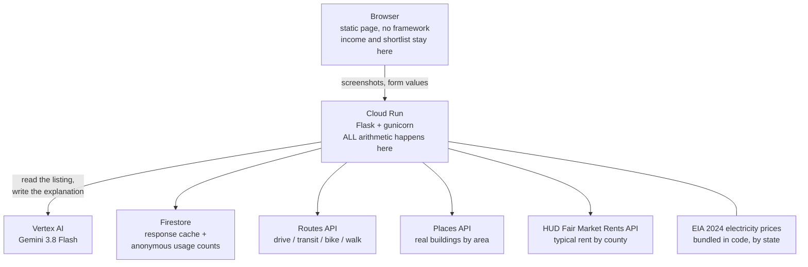

# True Cost of Rent

**A listing price is not what you pay.** Paste a screenshot of a rental
listing and this works out what the place actually costs each month, tells you
which charges the listing stayed silent about, and ranks the places you are
considering by what they really cost rather than what they advertise.

Built for GDG Build with AI x Hacktoberfest at Virginia Tech, October 2026.
Track: **Best Use of Google Cloud**.

**Live:** https://truecost-281435823029.us-east1.run.app

---

## The problem

Over 46 percent of US renters spend more than 30 percent of their income on
housing, and 23 percent spend more than half. People choose between places
using the number on the listing, and the number on the listing is not the
number that leaves their account. Utilities, parking, valet trash, water
billed back by formula, admin fees, amenity fees and the cost of the commute
are all real and none of them are in the headline price.

The people this hurts most are renting on their own for the first time. They
do not know those charges exist, so they do not know to ask.

### What that costs, in numbers this app produced

Two listings, both in Virginia, one bedroom, on a $2,400 monthly income:

| | Advertised | True monthly cost | Share of income |
|---|---|---|---|
| Cheaper listing, 15 miles out, no utilities included | $900 | $1,256 | 52% |
| Pricier listing, 2 miles out, all utilities included | $1,050 | $1,083 | 45% |

The listing price says the first is $150 cheaper. It actually costs **$173 a
month more**, or $2,076 a year. Going by the advertised price gets the
decision backwards, and it moves someone from not cost burdened to cost
burdened.

---

## What it does

**Check a place.** Drop in up to six screenshots of one listing. The model
reads them as a single listing, pulls out what is stated, and leaves blank
what is not. Every field is marked with where its value came from, so a
number you see is a number somebody supplied. Then the app computes the true
monthly cost and shows it against the 30 and 50 percent lines.

**Ask about these before you sign.** The app holds a catalogue of thirteen
charges that are routine in US rentals. The model's only job is saying which
ones this listing addressed. Everything it stayed silent about is surfaced
with a typical range and a plain explanation, and there is a button that turns
them into questions you can send the leasing office. The list separates two
kinds of silence: a charge never mentioned, and a charge with a section but no
price, which is worse because it looks like an answer.

**Move in specials.** A listing advertising "8 weeks free" on a 12 month lease
is quoting a first year price. The app shows the effective rent, the saving,
and the jump when it expires, and deliberately uses the full rent in the
headline figure so you see what the place costs once the special is gone.

**Per bed pricing.** Student housing is often sold by the bed, so $894 buys
one room in a four bedroom unit. Treating that as a whole apartment makes the
utility estimate roughly four times too high. The app detects it, including by
noticing that the top of a price range is the bottom times the bedroom count,
and splits everything accordingly.

**Explore an area.** Enter a town and your income. The app shows three things
and keeps them separate: what the area typically costs according to HUD, what
you can carry on your income, and what buildings are actually there. It does
not put a price on a specific building, because no public source publishes
rent per building and inventing one would be worse than useless.

**Shortlist.** Save several places and they are ranked by true cost. Stored in
your browser, never on the server.

---

## Architecture



### Google Cloud services used

| Service | What it does here |
|---|---|
| **Cloud Run** | Hosts the backend and serves the page. Scales to zero. |
| **Firestore** | Caches model responses, records anonymous usage counts. |
| **Vertex AI** | Runs Gemini 3.8 Flash. Authenticates by service account, no API key. |
| **Routes API** | Real travel time and distance between the listing and where you need to be. |
| **Places API** | Real apartment complexes for an area. |

Five services. The track requires two.

---

## How the AI is used, and what it never does

The model does exactly three things.

1. **Reads listings.** Up to six screenshots of one listing, plus text or a
   fetched page. Handles abbreviations, fee tables, pricing panels and content
   split across images. Returns null for anything not stated.
2. **Classifies what it read.** Is this fee monthly or one time. Is this one
   price or a range. Is this per bed or per apartment. Did the listing answer
   about parking or just put a heading there. These judgements are what make
   the arithmetic correct.
3. **Writes the explanation.** Two or three sentences about a result that was
   already computed.

**It never produces a number that reaches a calculation.** Rent splitting,
utilities, commute cost, concession maths, the burden percentage, the three
year projection, the affordability ceilings and the shortlist ranking are all
plain Python. The model's output lands in form fields the user can see and
correct before anything is computed from it.

This is deliberate. If the model did the arithmetic you could not tell a
correct answer from a confident wrong one, and you could not test it.

### Three times the model got it wrong, and what we changed

Each of these would have produced a believable wrong number.

| What happened | What we changed |
|---|---|
| A $200 one time admin fee was read as a monthly charge, inflating the result from 57 to 65 percent of income | Split the field in two, spread one time fees over the lease, and told the prompt explicitly that "at signing" means one time |
| A rent range of $1,150 to $1,800 came back as a single number nobody had quoted | The prompt now forbids averaging a range. It returns both ends and the UI says it is using the low one |
| A per bed price was treated as the whole apartment, making the utility estimate four times too high | Added detection, including the arithmetic check that the top of the range equals the bottom times the bedroom count |

A fourth was ours, not the model's: a suggestion to switch commute mode that
actually cost more than doing nothing. There is now a test asserting that no
suggestion is ever worse than the status quo, across every mode and distance.

---

## Grounding and safety

- All arithmetic in code, covered by 36 tests.
- The model is instructed never to invent a figure, and to return null for
  anything not stated. Blank fields in the UI are visibly blank and labelled.
- Fields show their provenance. Read from the listing, or not stated.
- The app refuses to compute a result when rent or income is missing, rather
  than returning a percentage built on zero.
- Figures that are estimates say so, next to the figure, not in a footnote.
- Nothing is presented as this building's price unless this building stated it.

## Privacy

Income, rent figures and the shortlist stay in the browser and are never sent
to the server. Per analysis the server writes one record: which of three
burden bands the result fell into, and whether the model was used. No rent, no
income, no address, no identifier.

Screenshots go to the Gemini API to be read and a hash keyed copy is cached.
Commute addresses go to the Routes API. Neither is tied to a person.

## Accessibility
**Lighthouse accessibility score: 100.**
Keyboard reachable throughout with a skip link and visible focus. Burden state
is carried in words as well as colour. Tables have scope and captions, live
regions announce status changes, and the layout works down to phone width.
Light and dark both supported.

---

## Data sources

| Figure | Source | Status |
|---|---|---|
| Electricity price by state | [U.S. Energy Information Administration, Table 5A, 2024](https://www.eia.gov/electricity/sales_revenue_price/pdf/table_5a.pdf) | Real data, cited in the UI |
| Typical rent by county and bedroom count | [HUD Fair Market Rents API](https://www.huduser.gov/portal/dataset/fmr-api.html) | Real data, 40th percentile gross rent |
| Travel times, places | Google Maps Platform | Live |
| Electricity consumption by unit size | Our assumption | **Estimate, labelled as such** |
| Water, gas, trash, internet costs | Our assumption | **Estimate, labelled as such** |
| Fee ranges in the catalogue | Broad national typicals | **Estimate, labelled as such** |
| Rent growth cases | Historical ranges | **Not a forecast, and says so** |

The split matters. The electricity figure is a real government price
multiplied by an assumed consumption, and the UI shows which half is which.

---

## Cost

Per analysis with two screenshots, on Gemini 3.8 Flash:

```
input    3,700 tokens x $0.75 per 1M = $0.00278
output     340 tokens x $3.75 per 1M = $0.00128
                                total  $0.0041
```

About four tenths of a cent. One screenshot is 0.31 cents, three is 0.50.
A thousand analyses costs roughly $4, ten thousand roughly $40.

Repeat reads of the same screenshot cost nothing: responses are cached in
Firestore keyed on a hash of the input, the model name and the prompt, so
changing either invalidates the cache. `/healthz` reports hits and misses.

Cloud Run scales to zero, so idle cost is nothing. Firestore usage sits inside
the free tier at this volume. **Places text search is the most expensive call
in the system, more than the model.** Check current Maps pricing before
running it at volume.

---

## Running it yourself

Requires a Google Cloud project with billing enabled.

```bash
# 1. Enable the services
gcloud services enable run.googleapis.com firestore.googleapis.com \
  cloudbuild.googleapis.com artifactregistry.googleapis.com \
  aiplatform.googleapis.com routes.googleapis.com places.googleapis.com

# 2. Create the database
gcloud firestore databases create --location=us-east1

# 3. Let the runtime service account reach Vertex AI and Firestore
PID=$(gcloud config get-value project)
PNUM=$(gcloud projects describe $PID --format='value(projectNumber)')
SA=${PNUM}-compute@developer.gserviceaccount.com
for r in roles/cloudbuild.builds.builder roles/storage.objectAdmin \
         roles/artifactregistry.writer roles/logging.logWriter \
         roles/datastore.user roles/aiplatform.user; do
  gcloud projects add-iam-policy-binding $PID \
    --member=serviceAccount:$SA --role=$r --condition=None --quiet
done

# 4. A Maps key, restricted to the two APIs it needs
gcloud services api-keys create --display-name="truecost-maps" \
  --api-target=service=routes.googleapis.com \
  --api-target=service=places.googleapis.com

# 5. Deploy
gcloud run deploy truecost --source . --region us-east1 --allow-unauthenticated \
  --set-env-vars PROJECT_ID=$PID,LOCATION=global,MODEL_NAME=gemini-3.8-flash,\
MAPS_API_KEY=your_key,HUD_TOKEN=your_token
```

A free HUD token comes from
https://www.huduser.gov/portal/dataset/fmr-api.html

### Environment variables

| Variable | Required | Notes |
|---|---|---|
| `PROJECT_ID` | yes | Google Cloud project |
| `LOCATION` | yes | `global`. Current Gemini models do not serve from regional endpoints. |
| `MODEL_NAME` | yes | `gemini-3.8-flash` |
| `MAPS_API_KEY` | no | Without it, commute and place search are unavailable and say so |
| `HUD_TOKEN` | no | Without it, area rent benchmarks are unavailable and say so |

No key appears in this repository. Every external credential is an
environment variable on the service.

### Tests

```bash
python3 test_cost_model.py
```

36 tests covering the arithmetic, splitting, per bed pricing, concessions, the
fee catalogue, the levers and the affordability ceilings. They need no
credentials.

---

## Limitations

Stated plainly, because a tool about hidden costs should not hide its own.

- **Utility consumption by unit size is an assumption.** The price per kWh is
  real EIA data. How much a given apartment uses is our estimate.
- **Fee ranges are broad national typicals**, not this building's prices.
- **Large listing sites block server side reading.** Apartments.com returns
  403. Screenshots are the reliable path and the app says so rather than
  failing quietly.
- **Rent growth cases are historical ranges, not predictions.** Nobody can
  predict a specific landlord's increase and the app does not pretend to.
- **The area search cannot price a specific building,** because no public
  source publishes that.
- **Promotional cloud credit expires on a date, not when the money runs out.**
  We lost ours mid build. The running cost is not the sustainability risk for
  an organisation adopting this; credit that ends on a calendar is.

## Where this goes next

The honest limit of the current version is that reading a listing is something
a general chat model can do. The decision layer on top is the part that is not.
The natural next feature is reading the **lease** rather than the listing:
early termination clauses, automatic renewal, joint and several liability, and
what actually comes out of the deposit. That is a document nobody reads before
signing, and pulling the consequential clauses out of it is work a chat window
cannot do well without the structure around it.

## Licence

MIT. See [LICENSE](LICENSE).
